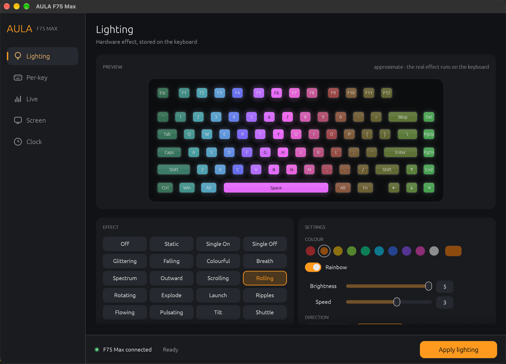
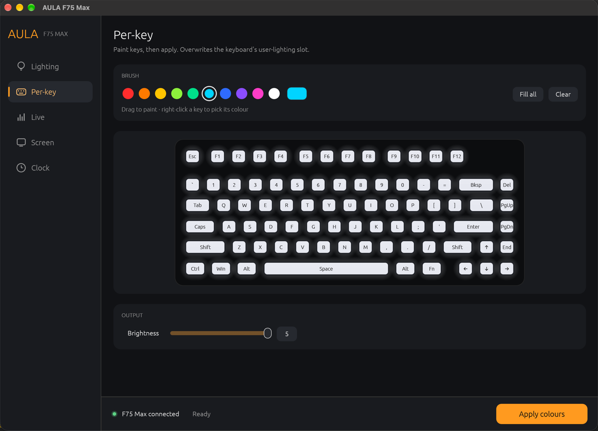
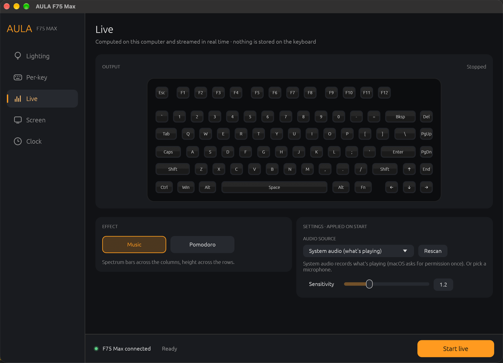

# aula75

**Unofficial control app for the AULA F75 Max keyboard on Linux and macOS.**
Written in Rust with an [egui](https://github.com/emilk/egui) interface. The vendor only ships a Windows driver, so the USB protocol was reverse engineered from it with Ghidra ([protocol notes](docs/PROTOCOL.md)).



## Features

| | |
|---|---|
| **Lighting** | The 19 built-in effects plus "off", with colour, rainbow, brightness, speed and direction. Each effect only shows the settings it supports. The preview **mirrors the keyboard**: it shows the colours the keyboard reports it is displaying. |
| **Per-key** | Paint individual keys and store them in the keyboard's user-lighting slot. **Load from keyboard** copies what it currently shows. |
| **Live** | Effects computed on your computer and streamed in real time. Nothing is written to the keyboard's memory. <br>• **Music**: a spectrum visualiser driven by system audio (whatever is playing) or a microphone <br>• **Pomodoro**: F1–F12 burn down as a timer, and the board pulses when the phase changes <br>• **Effects**: the vendor driver's own nine real-time effects (Star, Rain, Flower, Breath, Spectrum, Spring, Vertical, Roll, Rotate), ported from its code and colour tables |
| **Screen** | Put a PNG, JPG or animated GIF on the 128×128 TFT, or make one: rendered text (static or scrolling) or 32×32 pixel art. Up to 255 frames, with an animated preview. |
| **Clock** | Set the TFT clock to your computer's local time. |
| **Tray icon** | On Linux: Live controls from the status bar, and closing the window keeps live effects running. |
| **Command line** | The same actions for scripts and hooks, e.g. `aula-control light breath color=00c8ff`. |

Settings are remembered between launches.

<p>
  
  
</p>

## Built to not brick your keyboard

The tool only knows the commands it needs, and every byte it sends was checked against the vendor driver's code. Several behaviours were also confirmed on the real keyboard.

- **Allowlist only.** Firmware update, factory reset, key remapping and macros are deliberately **not implemented**, and there is no way to send a raw command byte.
- **Validated values.** Effects, levels, directions, LED indices and screen frames can only be built from checked types, never from arbitrary numbers.
- **No half-written settings.** A stored write is a transaction: begin, command, data, then apply. A marker file is written **before** the transaction starts and removed only after it succeeds. If the write fails, or the app crashes or is killed in the middle, the marker stays. Every window and command then refuses that keyboard **until it is unplugged and replugged**, so a later "apply" can't commit the leftovers.
- **Busy is not broken.** When the keyboard answers "busy" (for example during quick repeated changes), the app waits and asks again, as the vendor driver does. If it is still busy before anything was written, the app says *try again* instead of locking.
- **Live effects never touch flash.** They use only the real-time command the vendor's own music mode streams, never the command that stores colours.
- **Known hardware only.** The app refuses to write unless the device is a wired F75 Max (`0c45:800a`) with firmware it was verified against (`0x0110`). It also refuses if two F75s are connected.
- **One writer at a time.** Within the app, a single worker thread owns the device. Across processes, a lock lets only one window or command use the keyboard.

> [!WARNING]
> This is a reverse-engineered, unofficial tool. It is careful, but you use it at your own risk.

## Install

### Linux, prebuilt

From the first tagged version on, download `aula-control-<version>-linux-x86_64.tar.gz` from [Releases](https://github.com/serpentcarcass/aula75/releases). It contains the binary, the udev rule, this README and the license. The binary needs the PipeWire and udev libraries, which every desktop distribution ships.

### From source

You need Rust **1.88+** ([rustup](https://rustup.rs)).

```sh
git clone https://github.com/serpentcarcass/aula75.git
cd aula75
cargo run --release
```

On Linux, install the build dependencies first. These are the Debian/Ubuntu package names; Arch has them under similar names:

```sh
sudo apt install build-essential pkg-config clang libclang-dev libudev-dev \
  libpipewire-0.3-dev libspa-0.2-dev libxkbcommon-dev libwayland-dev \
  libxcb-render0-dev libxcb-shape0-dev libxcb-xfixes0-dev
```

### Linux setup

> [!NOTE]
> The Linux build is checked by CI, but it **has not been tested on real hardware yet**. Reports are welcome.

Give your user access to the keyboard's two vendor interfaces. The typing interface stays root-only, so other programs can't read your keystrokes:

```sh
sudo cp 70-aula-f75max.rules /etc/udev/rules.d/
sudo udevadm control --reload && sudo udevadm trigger
```

Run it as your normal user from a desktop session, not with `sudo`.

- **System audio** capture uses PipeWire and records what your default output is playing.
- **Tray icon**: KDE shows it out of the box. **GNOME** needs the *AppIndicator and KStatusNotifierItem Support* extension.
  - With the icon, closing the window keeps the app running. On X11 the window hides.
  - On Wayland windows can't be hidden, so it minimises instead. Bring it back from the dock or Alt-Tab.
  - Without a tray host, closing the window quits.

### macOS

No extra setup is needed. For **Music → System audio**, macOS 14.6 or newer asks once for permission to record system audio. There is no tray icon on macOS.

## Usage

The keyboard has to be connected **by USB cable**. The 2.4 GHz dongle and Bluetooth are not supported. The bottom bar shows whether the keyboard is connected, plus the current tab's main action.

- **Lighting**: pick an effect, adjust it, then press **Apply lighting**. With **Mirror keyboard** on, the preview shows what the keyboard displays. Turn it off to see a simulation of the selected effect instead.
- **Per-key**: drag to paint and right-click a key to pick up its colour, then press **Apply colours**. **Load from keyboard** starts from what it currently shows.
- **Live**: choose Music, Pomodoro or one of the vendor Effects, then **Start live** and **Stop**. Settings take effect when you start.
- **Screen**: choose Image (drop a file onto the window), Text (then **Render**) or Pixel art. Tick the confirmation, then press **Upload to screen**. This replaces the animation stored on the keyboard.
- **Clock**: press **Sync clock**.

### Command line

Run with a command instead of opening the window, e.g. from scripts or hooks:

```sh
aula-control modes
aula-control light breath color=00c8ff brightness=4 speed=2
aula-control light rolling rainbow dir=left
aula-control clock
aula-control screen cat.gif --yes
aula-control live pomodoro focus=50 break=10   # Ctrl-C to stop
aula-control live music                        # system audio
aula-control live spring speed=12              # a vendor effect
```

Only one window or command can use the keyboard at a time, so close the window before running commands. Out-of-range values, unknown options and options an effect doesn't support are rejected instead of being clamped.

If you see *"A previous write was interrupted"*, unplug the keyboard for a few seconds and plug it back in.

## Development

```sh
cargo test                                         # packet layouts, effects, generators, safety checks
cargo test -- --ignored system_audio --nocapture   # manual: prints live spectrum while audio plays
cargo clippy --all-targets -- -D warnings
```

CI (GitHub Actions, Ubuntu) runs fmt, clippy and the tests on every push. On a `v*` tag it attaches a Linux build to the release.

| File | What's in it |
|---|---|
| `src/proto.rs` | USB/HID protocol, validated types, command allowlist, process lock and write-ahead marker |
| `src/main.rs` | UI and the device worker thread |
| `src/cli.rs` | Command-line interface |
| `src/effects.rs` | Live effects: spectrum analysis, Pomodoro, ported vendor effects |
| `src/screen.rs` | Screen frames: image/GIF decoding, text rendering, pixel art |
| `src/tray.rs` | Linux status-bar icon (StatusNotifierItem over D-Bus) |
| `src/layout.rs`, `src/vendor_tables.rs` | Key layout, LED indices and effect tables taken from the vendor driver |

## License

[MIT](LICENSE)

## Not affiliated

AULA and Epomaker are trademarks of their respective owners. This project is not affiliated with or endorsed by them, and it contains none of their program code. For compatibility it includes small data tables taken from their driver: the key layout and the effect colour and brightness curves.
